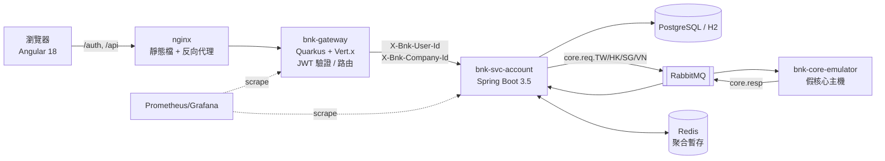

# bnktest_try — 迷你企業網銀（架構練習專案）

用最小的程式碼重現一套「企業網路銀行」常見的微服務架構：
**Angular 前端 → Quarkus API Gateway → Spring Boot 微服務 → MyBatis / DB、RabbitMQ 電文、Redis 聚合 → 核心主機模擬器**。

> 全部資料（統編、帳號、餘額）都是虛構的；專案不含任何公司名稱、內網位址、金鑰或真實帳密。
> JWT 金鑰在 gateway 啟動時才臨時產生，Git 裡沒有私鑰。

## 架構



## 模組

| 模組 | 技術 | 角色 |
|---|---|---|
| `bnk-shared` | Java 21 | ApiRequest/ApiResponse 信封、核心電文 DTO、遮罩工具 |
| `bnk-mod-account` | Spring Boot、MyBatis | 業務模組（jar，不單獨部署）：`api / usecase / domain / infra` 四層 |
| `bnk-svc-account` | Spring Boot、Actuator | 把業務模組組成可部署服務 + 監控 + DB driver |
| `bnk-core-emulator` | Spring AMQP | 假核心主機：收電文、依 JSON 範本回覆 |
| `bnk-gateway` | Quarkus 3、Vert.x | 登入發 JWT、驗 JWT、轉發 |
| `bnk-ui` | Angular 18 standalone + signals | 登入、帳戶總覽、輪詢餘額 |
| `db/` | SQL | DDL / 範例資料（獨立版控） |
| `k8s/`, `docker-compose.yml` | Kubernetes / Compose | 部署 |
| `.github/workflows` | GitHub Actions | CI |
| `k6/` | k6 | 壓力測試 |

## 核心流程：非同步電文聚合（query → poll）

1. `POST /balances/query`：驗證帳號屬於登入者 → 建立聚合批次 `batchId` → 每個帳號發一筆 `BAL001` 電文 → **立刻**回 `batchId`
2. 主機（模擬器）各自在 0~1.5 秒內回覆，回覆寫入 Redis `batch:{batchId}:results`
3. 前端每 `pollIntervalMs` 呼叫 `POST /balances/result`，拿到「目前已回來的部分」，`done=true` 才停

好處：主機慢不會卡住 HTTP 執行緒；畫面逐筆顯示；任何一個 Pod 都能接續回答（狀態在 Redis）。

## 快速開始

### A. 零安裝模式（只要 JDK 21 + Maven + Node 22）

```bash
# 1) 後端：建置 + 跑全部測試（16 個）
mvn install

# 2) 開兩個終端機
java -jar bnk-svc-account/target/bnk-svc-account-0.1.0-SNAPSHOT.jar      # :8081（H2 + 程式內模擬主機）
java -jar bnk-gateway/target/quarkus-app/quarkus-run.jar                  # :8080

# 3) 前端
cd bnk-ui && npm install && npm start                                     # http://localhost:4200
# 登入：alice / demo1234
```

這個模式用 `local` profile：H2 記憶體資料庫、`bnk.corebank.mode=simulate`、`bnk.batch.store=memory`，不需要 Docker。

### B. 完整模式（Docker：PostgreSQL + Redis + RabbitMQ + 主機模擬器）

```bash
cp .env.example .env            # 修改密碼
mvn -DskipTests install
mvn -pl bnk-svc-account,bnk-core-emulator jib:dockerBuild
# Apple Silicon (M 系列) 請加：-Djib.from.platforms=linux/arm64
docker compose up -d --build
docker compose --profile obs up -d      # 選用：Prometheus :9090、Grafana :3000
```

RabbitMQ 管理介面：http://localhost:15672（帳密寫在 .env）

### C. Kubernetes（本機 kind / minikube）

```bash
kind create cluster
kind load docker-image bnk/bnk-svc-account:0.1.0-SNAPSHOT bnk/bnk-core-emulator:0.1.0-SNAPSHOT
kubectl apply -f k8s/00-namespace.yaml
kubectl -n bnk create secret generic bnk-secret --from-literal=DB_PASSWORD=xxx --from-literal=RABBIT_PASSWORD=xxx
kubectl -n bnk create configmap bnk-initdb --from-file=db/
kubectl apply -f k8s/02-config.yaml -f k8s/10-infra.yaml -f k8s/20-apps.yaml
```

### 壓力測試

```bash
k6 run -e BASE=http://localhost:8080 -e VUS=10 -e DUR=1m k6/smoke.js
```

## API 一覽（全部 POST，JSON 信封 `{header, body}`）

| 路徑（經 gateway） | 說明 |
|---|---|
| `/auth/login` | `{userId, password}` → JWT |
| `/api/account/accounts/list` | 取登入統編下的帳號 |
| `/api/account/accounts/alias` | 設定帳號暱稱 |
| `/api/account/balances/query` | 發起餘額查詢，回 `batchId` |
| `/api/account/balances/result` | 輪詢結果 |

回應一律 HTTP 200，業務結果看 `returnCode`：`0000` 成功、`E001` 輸入錯誤、`E002` 未登入、`E003` 無帳號權限、`E004` 批次不存在。

## 需要帳號或付費的部分 → 免費替代

| 企業環境常見 | 這個專案用的免費方案 | 需不需要註冊 |
|---|---|---|
| 私有 Maven 倉庫 | Maven Central（`.mvn/settings.xml` 已設定） | 不需要 |
| SQL Server | PostgreSQL 17 / H2；若要練 SQL Server：`mcr.microsoft.com/mssql/server` Developer Edition（免費，僅限開發） | 不需要 |
| 私有映像倉庫 | 本機 Docker、`kind load`；要推上雲端用 GitHub Container Registry (ghcr.io) | GHCR 需 GitHub 免費帳號 |
| 自架 CI 伺服器 | GitHub Actions（公開 repo 免費、私有每月 2,000 分鐘） | 需 GitHub 免費帳號 |
| Docker Desktop（大型企業需付費授權） | 個人/小型公司免費；替代：Colima、OrbStack（個人免費）、Rancher Desktop、Podman Desktop | Docker Desktop 個人免費需登入可略過 |
| 正式 Kubernetes 叢集 | kind / minikube / k3d（本機、免費） | 不需要 |
| 核心主機 | `bnk-core-emulator` | 不需要 |
| HSM 硬體加密模組 | 開發用 SoftHSM2（OpenSSL 系列免費開源）或 JCA KeyStore | 不需要 |
| 簡訊 OTP | TOTP（RFC 6238，Google Authenticator 相容，免費）；Email 測試用 MailHog/Mailpit | 不需要 |
| 監控 SaaS | Prometheus + Grafana OSS（`--profile obs`）；Tracing 用 Jaeger all-in-one | 不需要 |
| 商用原始碼掃描 | SonarQube Community、SpotBugs、OWASP Dependency-Check、Trivy（映像掃描） | 不需要 |
| 壓測工具授權 | k6（開源） | 不需要 |

## 測試

| 測試 | 位置 | 內容 |
|---|---|---|
| 單元 | `BalanceDomainTest`, `MaskUtilTest` | 電文產生、幣別加總、遮罩 |
| 整合 | `AccountApiIntegrationTest` | 真的啟動 Spring + H2，驗證登入、越權、輸入驗證、query→poll 全流程 |
| Gateway | `GatewayTest` | 登入成功/失敗、無 token、竄改 token、未知服務、health |
